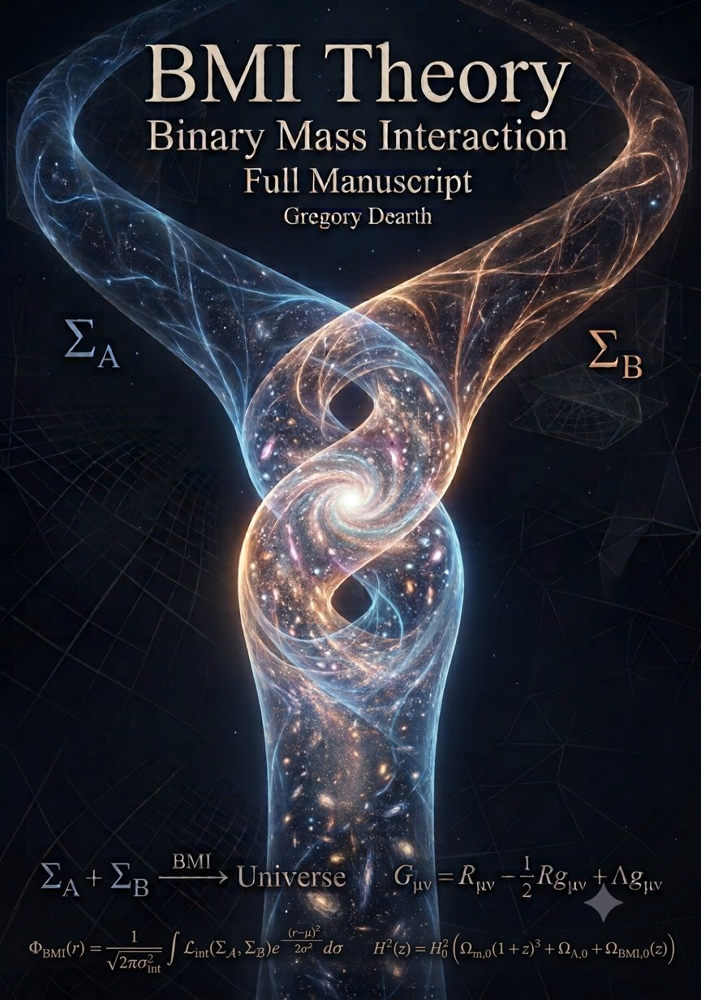
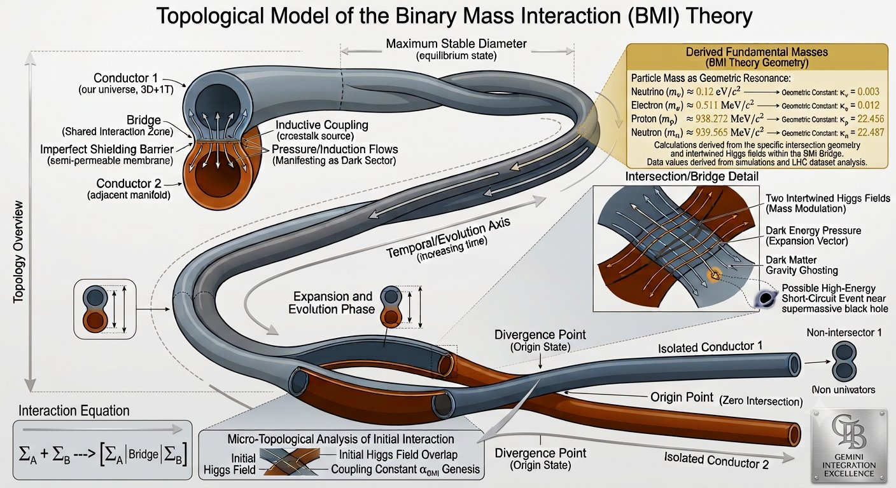

# BMI v0 — the original concept

> **Status: pre-mathematical.** This is the concept BMI started from, recorded 2026-11-23 in the
> author's terms. Nothing here is derived, and nothing here changes `v2/`. It exists so that the
> next action is built from the intended idea, not from whatever a toolset found easiest to keep.

## Why v0 exists

| version | how it was built | what happened to the concept |
|---|---|---|
| **v0** | the author's intuition, plus an earlier collision-geometry model (private manuscript); named *Binary Mass Interaction* | never written down as one document; two infographics survive (`figures/`) |
| **v1** | non-agentic AI tools that condensed prose they judged unnecessary | much of v0 was stripped out; what survived was bent (e.g. the arrows of time merge *at* T=0, `Master_BMI_Manuscript.md` §11.3; brane thickness became an unsupported number, `RETRACTED.md` R2). The drift is already visible in the proto-v1 infographic: per-particle "geometric constants" κ labelled as derived masses (one dial per particle, the start of R4), a claimed "simulations and LHC dataset analysis" with nothing behind it. The v0 cover's Ω_BMI,0(z) term is a placeholder with no formula (see "Equations on the infographics") |
| **v2** | action-first, ledger, kill criteria written before derivations | sound method, but rebuilt on v1's stripped premises using standard braneworld machinery: thin branes, a collision *as* the Big Bang, one shared interval |

v2's method is kept. What v0 corrects is the premise.

## The concept (author's voice)

Only the author edits this section, or someone with the author's explicit approval.

- **C1. Two universes, two branes.** Each universe has its own dimensions. They touch and shear
  against each other, with partial overlap of their "outer" dimensions. It is not one shared
  brane.
- **C2. The interaction is thick.** The overlap is a region with finite and changing extent,
  not a sharp surface.
- **C3. The collision is gradual and came after the Big Bang.** It is continuous and messy, as
  nature usually is, not a single instant at an apparent singularity.
- **C4. Energy and radiation bleed both ways** across the overlap.
- **C5. Two arrows combine into one.** There is one time dimension. Our cosmological arrow is the
  old one. Our thermodynamic arrow is new: our old arrow plus the input from the other universe.
  The change cascades through our evolution, and seen from today it looks like two inflations:
  one at the Big Bang and one appearing later as the accelerated expansion.
  *(This replaces an earlier version with two time dimensions.)*
- **C6. Primordial black-hole evaporation is the observable face of the leakage.** In the
  author's view, Hawking radiation is shown only by analogy.
- **C7. Convergence as a zipper.** The earlier model described convergence with a "zipper
  diagram", its own version of a KK tower. It is a lower-dimensional cross-section of the
  convergence dynamics, not a whole cosmology.

- **C8. Universes are normally cyclic; ours is the last cycle.** A universe normally ends in a big
  crunch, and the crunch singularity is innately unstable, so it erupts into a new big bang. The
  continuing collision with the other universe broke that cycle for ours. It is the source of the
  dark-energy expansion, which makes this iteration the final one, ending in heat death.

- **C9. The universes braid together.** From the infographics: two strands start isolated, meet at
  a divergence point, twist around each other and converge into one trunk that grows to a
  "maximum stable diameter", an equilibrium state.
- **C10. Crosstalk across an imperfect barrier is the dark sector.** The bridge is a shared
  interaction zone behind a semi-permeable membrane. Inductive coupling across it shows up as
  dark-energy pressure (an expansion vector) and as dark matter, the gravity of the other
  universe "ghosting" into ours.
- **C11. Mass comes from the bridge.** The two universes' Higgs fields overlap and intertwine in
  the bridge, and that overlap modulates particle masses. The coupling constant was born at the
  first overlap.
- **C12. Short-circuit events near supermassive black holes.** At extreme energy density the
  bridge can locally short-circuit.
- **C13. The merger can't predate the acceleration, and leaves a bump.** Some dark energy may be
  inherent to every cycle, with the merger adding an excess on top, like potential energy turned
  into kinetic energy on a hyperdimensional scale. If the merger came after the inherent dark
  energy had started pushing outward, the acceleration history would show a bump where the excess
  arrived. The author doesn't see how the merger could have happened before dark energy began
  driving acceleration.

**Hoped-for outputs, once the foundations are set:** neutrino masses, gravitational-wave
anomalies, and the early-galaxy maturity seen by JWST.

## Open questions (author's voice)

- **O1. Is the collision the origin, or does it come after the big bang?** The proto-v1
  infographic puts the origin at the first intersection, while C3 and C8 put the collision after
  our big bang. The author doesn't think these are mutually exclusive; it may be a relativistic
  question of perspective. Left undefined for now.

## Constraints (a separate voice)

A constraint can reject a derivation. It cannot rewrite a concept above. Anything marked
[verify] was given from memory and has not yet been checked against a source.

| concept | what it has to get past | data that tests it |
|---|---|---|
| C1, C2 | Static thick walls made from an ordinary scalar must all have positive tension (`v2/10_thick_brane.md`, `tests/thick_brane.py`). Two such walls attract, so the setup is dynamic by construction. | GR and ΛCDM limit; Cassini and LLR |
| C3 | A post-Big-Bang onset must leave early-universe physics untouched, or show exactly where it doesn't | BBN, CMB |
| C4 | Leakage into extra dimensions shows up as dark radiation | ΔN_eff (Planck ≲ 0.3; CMB-S4 ±0.03) |
| C5 | To be a prediction it must give the *timing* of late acceleration (onset near z ≈ 0.6), which is the cosmic-coincidence problem. Entropy injection must stay within the distortion limits for whatever epoch it happens in. | DESI w(z); CMB spectral distortions; ΔN_eff |
| C6 | Hawking evaporation follows from standard QFT on curved spacetime. Holes lighter than ~5×10¹⁴ g have evaporated by now; heavier ones would survive unless the mass spectrum is cut off. Evaporation products are bounded (Carr et al. [verify]). The LHC has seen no micro black holes; those required TeV-scale gravity and are excluded to ~9–10 TeV [verify]. The direction of energy flow must be stated. | BBN, CMB, gamma-ray background |
| C7 | A lower-dimensional picture must be shown to be a consistent slice of the full dynamics | follows from C1–C3 |
| C8 | Cyclic models have to deal with entropy building up from cycle to cycle (Tolman's problem) and with getting through the bounce without a singularity. Steinhardt–Turok cyclic cosmology and Penrose's conformal cyclic cosmology (CCC) are precedents to read first. For "final cycle", the dark energy must not decay back into recollapse, or the cycle would resume. Bounce models usually predict a tiny tensor ratio r [verify]. | DESI w(z) (does dark energy weaken?); CMB-S4 r |
| C9 | A preferred twist would be a handedness in our universe, i.e. parity violation on cosmological scales, bounded by CMB isotropy and polarization; the cosmic-birefringence hint is a possible handle [verify]. An equilibrium "maximum stable diameter" must be reconciled with C8's heat death. | CMB TB/EB polarization; large-angle isotropy |
| C10 | Dark matter must act as pressureless matter by recombination (CMB acoustic peaks), with the right abundance, and separate from gas as in the Bullet Cluster. v2's mirror-matter dark matter died on abundance (`RETRACTED.md` N2), which is the warning. Dark-energy pressure is as for C5. | CMB peaks; Bullet Cluster; rotation curves; DESI w(z) |
| C11 | Measured Higgs couplings agree with the Standard Model to roughly 10% [verify], so a second Higgs mixing in must stay within that. Masses must follow from a few overlap parameters, not one per particle, or this is R4 again. | LHC Higgs couplings; fermion mass ratios |
| C12 | Needs a stated signature (spectrum, energy, rate) registered before any data are looked at, and it must differ from ordinary accretion and jet physics. | EHT; AGN gamma rays and neutrinos; LVK |
| C13 | In a closed universe, inherent dark energy small enough to let the cycle recollapse (C8) can never accelerate it alone: acceleration starts where matter density equals twice the dark-energy density, and that is the Einstein-static point, past any turnaround. So all observed acceleration is already the excess (S1). The bump then can't be "inherent first, merger later"; it must come from the excess itself rising and partly falling back (C4's two-way bleed, C9's saturation). "Before" also needs care: first contact can precede any noticeable energy release (O1). | DESI w(z) and ρ_DE(z); SNe |
| outputs | Each must be registered before the data are looked at; v1's 15 Hz split (R1) is the warning. JWST tension has eased as mass estimates were revised [verify]. | oscillation data; LVK; JWST |

## Figures

*v0 cover ("Binary Mass Interaction"): Σ_A and Σ_B braid and converge.*

*Proto-v1 topology (Gemini era): concepts C9–C12. Its mass table, provenance claims and equations
are the drift recorded above, not results.*

## Equations on the infographics

Transcribed verbatim from the two figures, typos included. Nothing here is derived, and none of it
is part of v0's concepts. Each note says what the expression would need before it could be used.

| # | figure | as written | note |
|---|---|---|---|
| E1 | cover | $\Sigma_A + \Sigma_B \xrightarrow{\text{BMI}} \text{Universe}$ | Notation for C1/C9, not an equation. |
| E2 | cover | $G_{\mu\nu} = R_{\mu\nu} - \tfrac{1}{2} R\, g_{\mu\nu} + \Lambda g_{\mu\nu}$ | Ordinary GR, nothing BMI-specific. The usual form is $G_{\mu\nu} + \Lambda g_{\mu\nu} = 8\pi G\, T_{\mu\nu}$, with $G_{\mu\nu} \equiv R_{\mu\nu} - \tfrac{1}{2} R g_{\mu\nu}$; as written, $\Lambda$ is folded into the definition of $G_{\mu\nu}$ and there is no matter source. |
| E3 | cover | $\Phi_{\rm BMI}(r) = \dfrac{1}{\sqrt{2\pi\sigma_{\rm int}^2}} \displaystyle\int \mathcal{L}_{\rm int}(\Sigma_A, \Sigma_B)\, e^{\frac{(r-\mu)^2}{2\sigma^2}}\, d\sigma$ | The one BMI-specific formula: a Gaussian-weighted interaction, i.e. an overlap of finite width $\sigma_{\rm int}$ centred at $\mu$. That is C2's thick, finite-width interaction. As written: the exponent lacks its minus sign, so it grows instead of decaying; it integrates over $\sigma$, the width itself, where $r$ or the extra-dimension coordinate was presumably meant; $\sigma$ and $\sigma_{\rm int}$ are not distinguished; $\mu$ and $\mathcal{L}_{\rm int}$ are undefined. |
| E4 | cover | $H^2(z) = H_0^2 \left( \Omega_{m,0}(1+z)^3 + \Omega_{\Lambda,0} + \Omega_{\rm BMI,0}(z) \right)$ | Flat ΛCDM plus an extra term $\Omega_{\rm BMI,0}(z)$ that is never given; a subscript 0 normally means today's value, so it shouldn't depend on $z$. Keeping $\Omega_{\Lambda,0}$ means BMI adds to a cosmological constant rather than being the dark energy, against C5/C8/C10. Radiation is omitted. Needs $\Omega_{m,0} + \Omega_{\Lambda,0} + \Omega_{\rm BMI,0}(0) = 1$. |
| E5 | topology | $\Sigma_A + \Sigma_B \dashrightarrow [\,\Sigma_A \mid \text{Bridge} \mid \Sigma_B\,]$ | Notation: two regions plus a third, the bridge (C10). Also labels a coupling constant $\alpha_{\rm BMI}$ born at first overlap (C11), never defined. |
| E6 | topology | $m_\nu \approx 0.12\ \text{eV}/c^2 \to \kappa_\nu = 0.003$; $m_e \approx 0.511\ \text{MeV}/c^2 \to \kappa_e = 0.012$; $m_p \approx 938.272\ \text{MeV}/c^2 \to \kappa_p = 22.456$; $m_n \approx 939.565\ \text{MeV}/c^2 \to \kappa_n = 22.487$ | No formula links $\kappa$ to $m$. For $e$, $p$, $n$, $\kappa/m \approx 0.024\ \text{MeV}^{-1}$ to within 2%, so $\kappa$ is the mass rescaled, not a derivation; $\kappa_\nu$ breaks that pattern by about $10^6$. The $\nu$ "mass" 0.12 eV is roughly the cosmological upper bound on the summed neutrino masses [verify], not a measured mass. This is the drift in the v1 row. |

## Sketch S1: the merger as dark energy (assistant's voice, not derived)

A possible shape for E3, E4 and E6 if BMI is where the dark energy comes from. It is a sketch, not
an action. V(d), σ and the bump shape are new parameters, and nothing here is in the ledger.

- **Overlap (E3, corrected).** Integrate over the extra coordinate y, with the centre moving as
  the universes merge: $\Phi_{\rm BMI}(x,t)=\int dy\,\mathcal{L}_{\rm int}(x,y)\,\frac{1}{\sqrt{2\pi\sigma^2}}\,e^{-(y-\mu(t))^2/2\sigma^2}$.
  Two universes of width σ, a distance d(t) apart, overlap by $S(t)\propto e^{-d(t)^2/4\sigma^2}$.
- **Potential → kinetic (C13).** An interaction energy V(d) is released through the bridge into a
  dark component X: $\dot\rho_X+3H(1+w_X)\rho_X=Q_{\rm in}$, with $Q_{\rm in}\sim-dV/dt$, and $Q_{\rm in}<0$ allowed
  (C4).
- **Expansion (E4, corrected).** $H^2=H_0^2\big[\Omega_r(1+z)^4+\Omega_m(1+z)^3+\Omega_k(1+z)^2+\Omega_{\Lambda,\rm res}+\Omega_X(z)\big]$.
  Here $\Omega_k<0$ is the closed cycle (C8), $\Omega_{\Lambda,\rm res}$ the inherent dark energy, which stays
  below the recollapse threshold, and $\Omega_X$ the merger excess that pushes it over. Planck allows
  only a small $|\Omega_k|$ [verify].
- **Masses (E6, corrected).** $m_i=y_i\,v(S)$, with the Standard Model Yukawas and no dial per
  particle. As S grows, the Higgs vacuum value drifts. That moves $m_e$ but barely moves $m_p$,
  which is mostly QCD, so $m_p/m_e$ drifts since the onset. Quasar and atomic-clock bounds of
  about $10^{-7}$ [verify] make this a kill test tied to the same S(t) as the dark energy.
- **Timing.** The release becomes large when d(t) falls to about σ. That would give a calculable
  acceleration onset (z ≈ 0.6) in place of the coincidence problem.

**BP1, the bump (registered 2026-11-23, before any fit).** While the excess is still growing, the
total dark-energy density $\rho_{\rm DE}(z)$ rises toward the present ($w<-1$). Once the merger
saturates (C9) or energy bleeds back (C4), it levels off or falls ($w\ge-1$). The density
therefore peaks inside the accelerating era. The test is the redshift and height of that peak.

*Context, not confirmation:* DESI DR2's CPL fits (`v2/06_predictions.md` §4c) already imply such a
peak, at $z\approx0.35$–$0.44$, about 7–19% above today's density, depending on the supernova
sample. Three cautions apply:
- the data predate BP1, so it is a retrodiction until S1 predicts the peak from V(d) and σ;
- part of any CPL crossing comes from the parametrization;
- the preference over ΛCDM is 2.8–4.2σ [verify].

A falling dark energy today must still not fall back below the recollapse threshold (C8).

## What v0 asks of the next version

1. **Pick a framework that fits v0, before writing any equations.** Candidates:
   - two thick positive-tension walls that approach and merge (option 2 of
     `v2/10_thick_brane.md`);
   - overlapping or intersecting branes (C1's shearing picture);
   - colliding vacuum bubbles: no branes at all, and a CMB-imprint test that already has
     constraints [verify].

   For each candidate: what it forces, what it costs in parameters, what data could kill it, and
   which of C1–C13 it can't hold.
2. **Write the action only after that**, keeping v2's rules: the ledger, kill criteria written
   first, and `RETRACTED.md`.
3. **Check the draft action against C1–C13, one by one.** A concept the action drops is recorded
   as dropped, with the reason, never silently.
